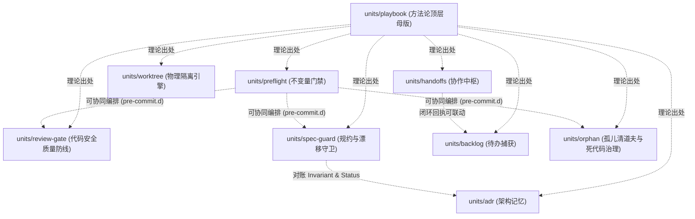

# 依赖与架构拓扑 (Dependency Graph)

## 1. Unit 拓扑架构

各模块处于扁平正交架构，各自独立演进，依赖关系如下：

## 2. Unit 详细清单与演进节奏

| Unit | 类型 | 版本源 | 外部依赖 | 演进频率 |
|---|---|---|---|---|
| `units/handoffs/` | Node CLI 引擎 | `VERSION.md` / README | Node.js >= 18 | 高频 (协作契约与状态机演进) |
| `units/worktree/` | Node CLI 引擎 | `VERSION.md` / README | git, Node.js >= 18 | 中频 (物理隔离与缓存优化) |
| `units/preflight/` | Shell 脚本 + 探针 | `VERSION.md` | git, POSIX shell | 中频 (探针与门禁项扩充) |
| `units/review-gate/` | Shell 脚本 + SAST | `VERSION.md` | opengrep, git | 低频 (规则与基线优化) |
| `units/adr/` | Shell 引导 + 模板 | `VERSION.md` | bash | 低频 (模板档位演进) |
| `units/spec-guard/` | Node CLI 引擎 | `VERSION.md` / README | Node.js >= 18 | 中频 (规约对账与边界探针演进) |
| `units/orphan/` | Node CLI 引擎 | `VERSION.md` / README | Node.js >= 18 | 中频 (死代码与孤儿依赖/凭证治理) |
| `units/backlog/` | 规范文档 + 模板 | `VERSION.md` | 无 | 低频 (记录格式演进) |
| `units/playbook/` | 文档与方法论全集 | `README.md` | 无 | 持续积累 |

## 3. 隔离与变更规则
1. **独立发布**：任一 Unit 的逻辑调整，仅在该 Unit 目录下 bump `VERSION.md` 并记录 `CHANGELOG.md`。
2. **跨 Unit 变更流程**：
   - 当 `handoffs` 调度契约变动影响到回执模板或 backlog 联动时，需在 `group/contracts/` 记录契约变更。
   - 跨 Unit 的重大架构与协作决策，须在 `group/architecture/adr/` 沉淀并冻结架构决策记录（ADR）。
   - 禁止在修改一个 Unit 时隐式篡改其他 Unit 的既有行为。
