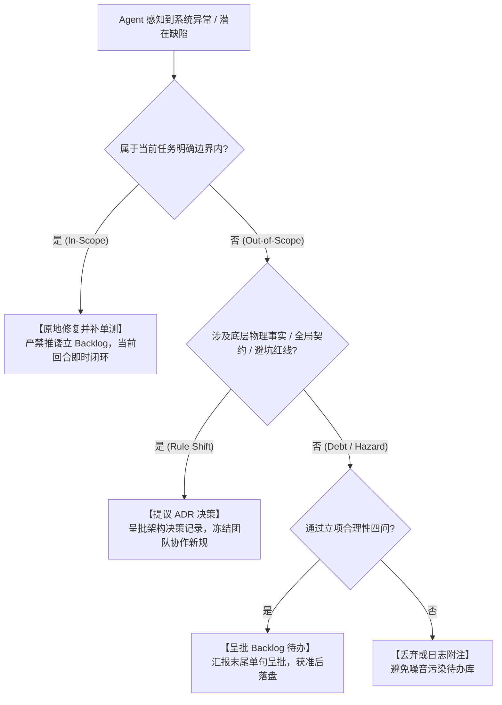

# Agent 自主治理与隐患嗅探规范 (Autonomous Governance & Discovery Spec)

> **版本**：v1.1.0 (2026-11-06)  
> **定位**：面向 AI Coding Agent 的自主架构防御与隐患捕获协议（公共中立基础设施，零业务硬编码）。

---

## 1. 目标与愿景 (Why Autonomous Governance)

传统的 AI 辅助编程往往使 Agent 陷入**“机械打补丁”**的狭隘视角——看到系统全局隐患装作不见，或在长跑中发现架构缺陷却保持沉默。
本规范旨在将 AI Agent 从“被动的敲代码工具人”，升级为**具备架构自驱力与系统免疫感知的“数字员工”**。

通过标准化的**分流漏斗**、**立项四问**与**单句呈批机制**，确保 Agent 的自主治理既具备极高的**敏锐度（发现真隐患）**，又保持极低的**噪音（杜绝垃圾待办）**。

---

## 2. 三态分流铁律 (Three-Tier Triage Funnel)

在执行任务、单测、长跑或代码审查时，一旦感知到异常或潜在隐患，Agent **必须首先通过三态分流漏斗**，严禁盲目立项：



### ① 即时闭环（In-Scope Fix）
- **判定**：缺陷属于当前任务、交接单（Handoff）或当前修改文件的直接职责。
- **动作**：**必须就地修复并补齐回归测试**。借故“留待以后解决”而写入 Backlog 视为严重失职与纪律违规。

### ② 架构决策（ADR 提案）
- **判定**：触碰底层物理硬件协议、跨端通信契约变更、反直觉避坑规则（需要全团队统一心智认知的规范）。
- **动作**：**必须提议立项 ADR**（落 `group/architecture/adr/`，是“规则与法”，不是待办）。

### ③ 后置待办（Backlog 提案）
- **判定**：跨越当前交付边界、需真实特定硬件/长时间长跑方可复现、或涉及业务/商业权衡必须人类拍板的事项。
- **动作**：通过下文“立项四问”筛选后，呈批建立待办（落 `docs/backlogs/`）。

---

## 3. 立项合理性四问 (The 4 Qualifications)

在提议建立 Backlog 前，Agent 必须在上下文中自检以下四道守卫：

| 序号 | 守卫问题 | 合格判据（必须全部为“是”） | 违规反例（任一命中则拦截） |
|:---:|---|---|---|
| **Q1** | **边界越界否？** | 确实超出了当前正在解决的单据/指令边界，无法在当前回合就地安全闭环。 | 顺手改两行就能好的当前单测失败，却立个待办推给以后。 |
| **Q2** | **事实度量否？** | 持有**真实的证据**（如采样日志、断连时序、明确的报错栈或抓包数据）。 | 凭空臆想“未来访问量大了可能会慢”、“建议引入分布式缓存”。 |
| **Q3** | **雪崩风险否？** | 若长期搁置，会导致**长跑卡死、孤儿进程残留、数据资损或全局阻断**。 | 纯属个人风格偏好的变量命名、微不足道的格式调整。 |
| **Q4** | **机器可判否？** | 未来接单者动工修复后，存在**明确的终端命令/测试用例（Exit 0）**可供验证。 | “优化用户体验”、“进一步提升代码优雅度”等模糊不可测描述。 |

---

## 4. 单句呈批制规约 (Single-Sentence Approval Protocol)

为了确保项目的最终治理权牢牢掌握在人类开发者手中，Agent **严禁静默创建 Backlog**。

### 汇报标准界面
当 Agent 完成当前回合工作，并在排查中发现符合上述标准的深水区隐患时，在汇报最末必须固定格式呈现：

```markdown
## 建议沉淀项
- 建议类型：[Backlog | ADR]
- 提议编号：<自动顺延编号，如 Backlog-063>
- 建议标题：<一句话精炼标题，如《多设备Host端口隔离与防篡改长跑实测》>
- 隐患根由：<基于实测采样的客观事实，严格限定 1~2 句>
- 严重级别：[P0/阻断 | P1/核心隐患 | P2/演进优化]
```

### 低摩擦闭环
- **人类回复**：只需在聊天框回复单句（例如：“**可**”、“**准**”、“**立项**”或“**忽略**”）；
- **执行动作**：仅在人类明确同意后，Agent 方可调用文件创建工具在 `docs/backlogs/` 写入新文件；若人类拒绝或忽略，不得二次纠缠。

---

## 5. 领域插座机制 (Domain Heuristics Hook)

公共机制只负责“流程漏斗与形状”，具体技术栈的雷区属于“领域业务”。

公共规范约定挂载点：各消费方工程的 **`docs/backlogs/IRONRULES.md`**（或其主说明文件）。
下游工程应在自身文件中声明《高敏感嗅探雷区》（Domain Sensitive Triggers）。进驻该工程的 Agent 会自动载入并激活专属嗅探雷达：

- **硬件/机队类工程（如 Tappy）**：聚焦端口争抢、防休眠失效、脱机剪枝、主事件循环阻塞；
- **系统守护/浏览器驱动类工程（如 Swoop）**：聚焦 CDP 连接泄漏、Chrome 僵尸进程、风控限流、内存暴涨；
- **商业全栈/小程序工程（如 一期一卉花）**：聚焦云数据库事务未原子化（防资损）、渲染白屏、越权鉴权。

---

## 6. 生命周期与反膨胀守卫 (Lifecycle Clamping)

1. **一任务一文件**：`docs/backlogs/<id>-<slug>.md`，纳入 git 跟踪；
2. **关闭即删文件**：任务完成并通过验收后，**直接删除该 markdown 文件**（真实历史永久保存在 Git log 与交付回执中）。确保待办目录永远只保留活跃且最重要的活工作，坚决消灭“僵尸需求堆积”；
3. **滞留报警**：CLI 工具（如 `baton check`）会自动巡检超过 7 天未流转推进的待办条目并提示预警，倒逼架构持续消化债务。
