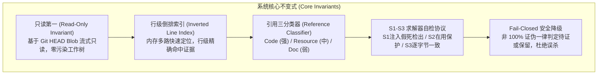
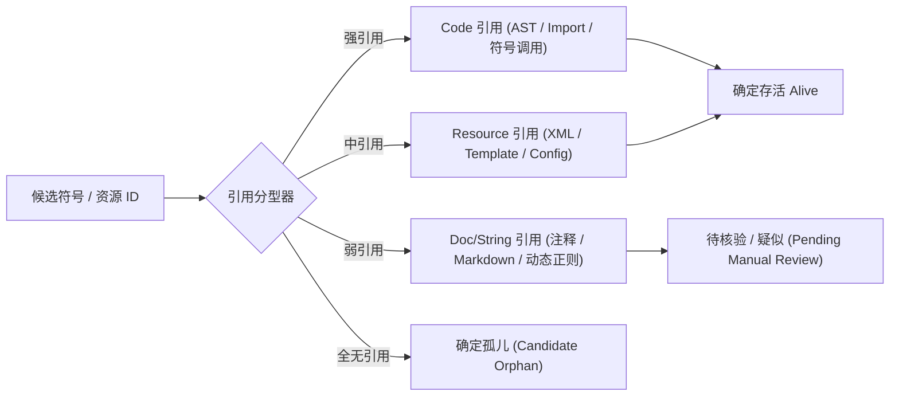
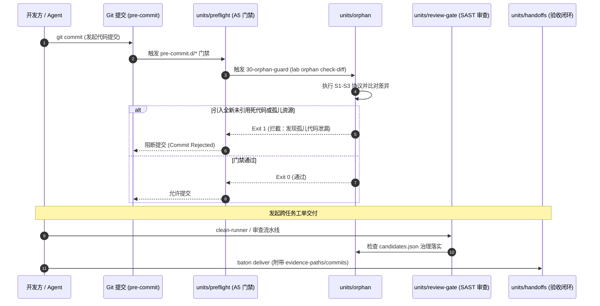

# 全局死代码与孤儿资产清道夫公共单元 (units/orphan) 架构设计方案

> **文件标识**：`units/orphan/DESIGN.md`  
> **所属版本**：v0.1.0-draft  
> **状态**：方案草案（Draft for Review）  
> **责任方**：`lane: impl` (实现方)  
> **面向对象**：`lab-agent-toolkit` 全局架构师、各消费方（Tappy, Swoop, Prospero, Iggle 等）技术负责人

---

## 目录
1. [背景与问题定义](#1-背景与问题定义)
2. [国际工业界与开源标杆深度调研](#2-国际工业界与开源标杆深度调研)
   - 2.1 Uber Piranha：基于 AST 重构的过期特性开关与死分支清道夫
   - 2.2 Knip：面向 JS/TS 生态的 Module Graph 与插件化导出级清理
   - 2.3 Android Lint UnusedResources：资源符号表追溯与反射防御
   - 2.4 Vulture：动态语言（Python）AST 启发式与置信度打分
   - 2.5 OpenGrep / Tree-sitter：通用 CST 模式匹配与跨文件调用图困境
   - 2.6 横向对比与工程选型矩阵
3. [核心设计哲学与系统不变式](#3-核心设计哲学与系统不变式)
   - 3.1 只读第一不变式（Read-Only Invariant）
   - 3.2 内存行级倒排索引（Inverted Line Index）
   - 3.3 引用分型器（Code / Resource / Doc）
   - 3.4 S1–S3 求解器自检协议（Solver Self-Test Protocol）
   - 3.5 Fail-Closed 安全降级原则
4. [分层架构设计（Layered Architecture）](#4-分层架构设计layered-architecture)
   - 4.1 核心层（Orphan Core Engine）
   - 4.2 适配器层（Technology Stack Adapters）
   - 4.3 数据契约规范（Candidates JSON Schema）
5. [公共集成与消费规范](#5-公共集成与消费规范)
   - 5.1 CLI 接口契约
   - 5.2 跨项目接入标准（`.orphanrc.json`）
   - 5.3 与 `preflight` 门禁与 `review-gate` 协同工作流
6. [落地实施路线图](#6-落地实施路线图)

---

## 1. 背景与问题定义

在大型多技术栈（Multi-stack: TypeScript/Node、Python、Android/Kotlin、Rust）及长期演进的代码仓库中，随着业务迭代、架构重构和代码迁移，代码库中会沉淀出大量「孤儿资产与死代码」：
- **未引用的代码符号**：已被废弃的类、函数、变量、类型别名、枚举；
- **死代码分支**：恒真/恒假的过期配置开关分支、无法到达的基本块；
- **孤儿资源资产**：从未被布局或逻辑引用的图标（SVG/PNG）、布局（XML/HTML）、样式、字体、国际化词条；
- **失效文档与配置**：历史废弃的 schema、示例、失效脚本与假依赖。

### 1.1 现状痛点
1. **认知负荷与构建膨胀**：死代码混淆团队认知，增加编译/打包体积，拖慢 CI/CD 速度；
2. **重构阻力与虚假安全感**：废弃代码仍被 IDE 索引，导致全局搜索与重构受到海量噪声干扰；
3. **Agent 误导陷阱**：在 AI 辅助研发（Agentic Engineering）场景下，上下文窗口极其宝贵。未清理的死代码与孤儿资产会导致 Agent 误读废弃逻辑并在此基础上继续衍生错误代码，造成严重工程漂移；
4. **清理缺乏安全感（误杀恐惧）**：由于动态加载、反射、字符串拼接调用等不确定性，开发人员与 Agent 往往不敢主动清理，陷入「代码只增不减」的死循环。

为彻底根治这一系统性问题，`lab-agent-toolkit` 决定立项建设公共清道夫单元——`units/orphan`，作为全局可复用的死代码与孤儿资产扫描、分析、验证与安全清理中枢。

---

## 2. 国际工业界与开源标杆深度调研

### 2.1 Uber Piranha：基于 AST 重构的过期特性开关与死分支清道夫
* **核心理念**：Uber Piranha 针对特性开关（Feature Flag）长期驻留导致的死代码债务，将清理过程彻底自动化。
* **工作机制**：
  - **输入明确**：输入具体的过期特性开关标识（Flag Name）及目标状态（Treatment/Control，即永久开启或永久关闭）。
  - **AST 语法树重写**：基于具体语言解析器（SwiftSyntax、Java Javac/ErrorProne、Polyglot Piranha 基于 Rust + Tree-sitter），在 AST 层面找到检查该 Flag 的 API 调用。
  - **布尔逻辑化简与剪枝**：将条件表达式化简（如 `if (true && X)` $\rightarrow$ `if (X)`；`if (false)` 分支直接剪枝删除），并递归清理仅在死分支内调用的局部方法或陈旧测试用例。
  - **端到端流水线（PiranhaTidy）**：通过后台定时任务自动识别 8 周未修改的 Flag，调用 Piranha 生成局部 Refactoring Patch，自动向原作者发起 Code Review PR，并配合 Bot 提醒合并。
* **适用与局限**：
  - **优点**：针对「已知明确开关」的死代码消除极度安全且精准，生成的 Diff 质量极高。
  - **局限**：无法进行全仓**无前置假设的盲扫（Unindexed Blind Discovery）**，不能自动发现未加开关的孤立无主代码或资源。

### 2.2 Knip：面向 JS/TS 生态的 Module Graph 与插件化导出级清理
* **核心理念**：全仓模块拓扑图（Module Graph）与集合减法（Set Mathematics）。
* **工作机制**：
  - **入口确定（Entry Points）**：确定项目顶层入口（如 `main.ts`、Next.js pages、Vite 页面）。
  - **AST 导入导出追踪**：深入遍历 TypeScript/JavaScript AST，建立全局完整的 `Import -> Export` 依赖图谱。
  - **集合运算判死**：
    $$\text{Unused Files} = \text{Project Files} - (\text{Entry Files} + \text{Reachable Files})$$
    $$\text{Unused Exports} = \text{Reachable Exports} - \text{Referenced Exports}$$
  - **插件化生态（Plugins）**：解决现代 Web 框架中大量以字符串引用的配置文件（如 Tailwind、PostCSS、Jest、ESLint、Vite 等）。通过 100+ 专用插件读取框架配置，将隐式依赖显式注册回模块拓扑图。
* **适用与局限**：
  - **优点**：在 JS/TS 生态极度强大，能精确定位未用文件、未用导出符号、未用类型声明以及 `package.json` 中的多余依赖。
  - **局限**：强绑定于 Node/TS 模块系统，无法直接处理跨语言混合仓库（如 Android XML 与 Kotlin 混用、Python 动态调用），且构建全量 TS AST 内存占用极高。

### 2.3 Android Lint UnusedResources：资源符号表追溯与反射防御
* **核心理念**：面向移动端原生资源的符号表（R Class / Resource Table）跨层图谱分析。
* **工作机制**：
  - **双向比对**：将 `res/` 目录下声明的所有资源（layout, drawable, string, id, style 等）编译为资源符号表，同时分析 Java/Kotlin 字节码/AST 以及 XML 布局，构建资源引用图。
  - **反射与动态拼接挑战**：Android 中存在 `getResources().getIdentifier("name", "drawable", pkg)` 或通过 `Class.forName("com.app.R$string")` 动态获取资源 ID 的场景，静态分析极易报假死（False Positive）。
  - **多层防御机件**：
    - 代码级注水与豁免：`@SuppressLint("UnusedResources")`、XML `tools:ignore="UnusedResources"`；
    - 显式保留声明（Keep List）：`res/values/keep.xml` 中使用 `tools:keep="@drawable/ic_dynamic_*"` 声明模式保留；
    - 混淆与收缩协同：与 ProGuard / R8 共享 `-keep class **.R$*` 规则。
* **适用与局限**：
  - **优点**：针对 Android 原生资源拓扑极为完备，天然支持 XML 级联引用推导。
  - **局限**：严重依赖 Gradle/Android SDK 构建上下文；执行速度较慢，且在非 Android 项目完全无法复用。

### 2.4 Vulture：动态语言（Python）AST 启发式与置信度打分
* **核心理念**：针对纯动态语言的 AST 启发式统计与概率置信度分级（Confidence Scoring）。
* **工作机制**：
  - **AST 全局遍历**：使用 Python 标准库 `ast` 解析所有 `.py` 文件，提取所有类定义、函数定义、属性赋值和导入语句。
  - **置信度阶梯（60%–100%）**：
    - `100% 置信度`：绝对不可达代码（如 `return` / `raise` 之后的死代码基本块）或函数内部未引用的局部参数；
    - `60%–90% 置信度`：模块顶层函数、类、类属性——无法排除在其它未显式引用的地方被 `getattr()`、动态导入或外部消费方使用。
  - **白名单机制（Whitelist）**：支持 `vulture --make-whitelist > whitelist.py` 自动固化当前存量假阳性，并写入 `pyproject.toml` 排除特定模式。
* **适用与局限**：
  - **优点**：轻量级、无第三方重型依赖，能极快给出 Python 代码中的孤儿线索。
  - **局限**：由于缺少严格类型与模块系统，误报率显著高于静态类型语言；若无置信度分流和人工核验，直接自动清理极具破坏性。

### 2.5 OpenGrep / Tree-sitter：通用 CST 模式匹配与跨文件调用图困境
* **核心理念**：基于具体语法树（CST）的多语言通用结构化模式查询。
* **工作机制**：
  - **高效 Tree-sitter 引擎**：将各类源码解析为标准统一的 CST，支持使用同构的语法通配符（Metavariables）匹配特定的函数定义、变量声明等模式。
  - **单文件分析极强**：在单个文件内分析死分支（如无用局部赋值、无用局部导入）极快且极精准。
* **适用与局限**：
  - **优点**：多语言支持极其广泛、解析速度极快、开箱即用。
  - **局限**：社区开源版（如 Opengrep / Semgrep CE）主要聚焦于**单文件上下文**。全仓级别的「死函数/死资源」跨文件引用追踪需要维护全局符号表与跨文件 Call-Graph，纯靠 CST 规则匹配难以承担全项目孤儿求解。

---

### 2.6 横向对比与工程选型矩阵

下表总结了工业界各标杆工具的核心维度对比：

| 工具 / 方案 | 分析范式 | 范围跨度 | 跨语言能力 | 动态/反射防御 | 误报控制方案 | 工作树状态依赖 |
|---|---|---|---|---|---|---|
| **Uber Piranha** | AST 语义化简与重构 | 单项目 (Flag 驱动) | 多语言 (逐栈 AST / Rust) | 否（仅针对已确认 Flag） | 针对已知 Flag，误报率 $\approx 0$ | 读写工作区 (生成 PR) |
| **Knip** | Module Graph + 集合减法 | 全仓 / Monorepo | 仅 JS/TS 生态 | 弱（靠插件解析字符串） | 插件解析 Config + entry 配置 | 读工作树文件 |
| **Android Lint** | 符号表追溯 + 字节码 | Android 工程 | Kotlin/Java + XML | 中（支持 `tools:keep`） | `tools:keep` 规则通配符保留 | 依赖 Gradle 构建态 |
| **Vulture** | AST 启发式词法统计 | 单项目 | 仅 Python | 极弱（动态反射无法感知） | 置信度分级（60%-100%）+ Whitelist | 读工作树源码 |
| **OpenGrep / Tree-sitter** | CST 结构化模式匹配 | 单文件 (局部) | 全语言通用 | 无 | 靠精细规则与负向断言过滤 | 读文件流 |
| **units/orphan (本方案)** | **Git HEAD Blob 只读流 + 行级倒排索引 + AST 适配器** | **全仓跨目录多技术栈** | **统一 Core + 多栈 Adapter** | **强（三分类器 + Fail-Closed）** | **S1-S3 自检协议 + 严禁硬编码白名单** | **只读 Git HEAD blob，零污染** |

### 2.7 调研核心启示与选型决策
1. **单一 AST 无法兼顾全栈跨语言**：TS 的 AST 无法理解 Android XML 资源；Python 的 AST 无法直接解析 Web 模板。必须将「底层全文符号索引与跨技术栈引用关系」与「上层特定语法树适配器」解耦。
2. **纯文本正则 Grep 误报极高，纯 AST 解析无法覆盖隐式引用**：必须采用**三分类器（Code / Resource / Doc）**，区分强绑定代码引用、中等绑定资源引用与弱绑定文本/注释引用。
3. **不能把「假装干净」当作清洁**：工具严禁依赖硬编码的临时白名单。必须建立严格的 **S1–S3 求解器自检协议**，确保算法本身的正确性能够被持续自证。
4. **Agent 执行环境的绝对零污染**：任何分析不能在工作树生成中间缓存文件，严禁污染 `git status`，所有候选提取必须严格基于 Git HEAD blob。

---

## 3. 核心设计哲学与系统不变式

`units/orphan` 确立了四项不可妥协的核心架构原则与不变式：



### 3.1 只读第一不变式（Read-Only Invariant）
* **原理**：求解器扫描与求值过程**绝对禁止写入或修改当前工作区**。
* **机制**：
  - 源码与资源文件的读取一律通过 `git ls-tree -r -z HEAD` 获取文件索引，并通过 `git cat-file --batch` 或只读内存流提取 HEAD blob 内容；
  - 严禁依赖脏工作树（Dirty Working Tree）中的临时修改；
  - 扫描产物一律输出至指定报告文件（如 `--out candidates.json`）或标准输出，不在被测项目根目录下散落临时索引或隐藏数据库。

### 3.2 内存行级倒排索引（Inverted Line Index）
* **原理**：为支持高吞吐的跨文件引用判定，Core 在内存中构建轻量级倒排索引：
  - **Token 分词与规范化**：对代码标识符（PascalCase, camelCase, snake_case, kebab-case）进行分词切片与精确符号归一化；
  - **行级证据链（Line-Level Evidence）**：倒排索引精确记录 `symbol -> Set<{ path, line_no, line_content, context_type }>`；
  - **亚秒级判定**：任何待查候选符号可在毫秒内完成全仓逆向引用排查，无需对全仓反复执行低效的外部文本扫描。

### 3.3 引用分型器（Code / Resource / Doc）
为解决静态分析对字符串字面量、文档和注释的粗暴对待，建立引用三级分类器：



1. **Code 引用（强）**：AST 导入、类继承、接口实现、方法调用、注解引用。一旦命中，立即判定存活；
2. **Resource 引用（中）**：XML 布局绑定、资源 ID（`R.layout.*`, `@drawable/*`）、路由配置文件、i18n 字典 key；
3. **Doc / String 引用（弱）**：仅出现在 Markdown 文档、行内注释、日志格式化字符串或未识别的通用纯文本中。**此类引用不得直接视为存活**，但必须在报告中明确打标为 `REFERRED_IN_DOCS_ONLY`，供人工与 Agent 研判。

### 3.4 S1–S3 求解器自检协议（Solver Self-Test Protocol）
`units/orphan` 引入与 Tappy 实战同源的自检协议，严禁算法自说自话：

* **S1 (Injection Self-Test / 注入假死自检)**：
  - 在扫描启动前，算法向内存倒排索引中注入确定孤立的假符号（Synthetic Dead Symbol，如 `__ORPHAN_SYNTHETIC_DEAD_TOKEN_0xDEADBEEF__`）；
  - 求解器执行后，**必须 100% 将该合成假符号识别为孤儿候选**；若未检出，说明求解器存在漏报缺陷，判定执行失败（Exit 1）。
* **S2 (In-Use Protection / 在用保护自检)**：
  - 算法从用户指定的 Entrypoints（如应用主入口、已公布的核心 API、核心路由）或抽样真实活跃符号中提取基准存活集；
  - 求解器执行后，**严禁将存活集内的任何符号标记为孤儿**（误报率必须恒为 0）；若发生误杀，判定执行失败（Exit 1）。
* **S3 (Byte-Level Deterministic Reproducibility / 逐字节一致可重复)**：
  - 在同一 HEAD commit 下重复执行 3 次全量分析，所生成的 `candidates.json` 内容必须计算出逐字节一致的 SHA-256 哈希；
  - 候选列表在导出前必须执行确定性排序（按文件路径字典序升序、行号数字升序、符号名升序），杜绝由于哈希表无序遍历引入的竞态抖动。

### 3.5 Fail-Closed 安全降级原则
* 当求解器遇到以下不确定场景时，**一律判定为待证（Pending）或保留，严禁擅自判定为孤儿**：
  - 存在 `@Keep`、`@PublicApi`、`@VisibleForTesting` 等保护注解；
  - 涉及反射调用（如 `Class.forName`、`getIdentifier`、`getattr`）且无法进行常量推断；
  - 属于对外发布的公开 SDK / NPM / PyPI 模块的导出门面（Exports Entrypoint）。

---

## 4. 分层架构设计（Layered Architecture）

`units/orphan` 采用微内核 + 可插拔适配器（Microkernel + Adapters）的分层架构：

```
units/orphan/
├── README.md               # Unit 规范与接入指引
├── DESIGN.md               # 本架构设计方案
├── VERSION.md              # 单一版本事实源
├── CHANGELOG.md            # 变更日志
├── bin/
│   └── orphan.mjs          # CLI 统一入口 (lab orphan <cmd>)
├── core/                   # 核心求解器引擎 (Language-Agnostic Core)
│   ├── blob-reader.mjs     # Git HEAD blob 只读流提取器
│   ├── inverted-index.mjs  # 内存行级倒排索引
│   ├── classifier.mjs      # 引用三分类器 (Code/Resource/Doc)
│   ├── protocol-s1-s3.mjs  # S1-S3 求解器自检门禁套件
│   └── solver.mjs          # 统一图求解与判死核心
├── adapters/               # 各技术栈语言与资源适配器
│   ├── base.mjs            # 适配器抽象契约 (IOrphanAdapter)
│   ├── android/            # Android 原生适配器 (Manifest/R/XML/Kotlin)
│   │   ├── index.mjs
│   │   ├── manifest.mjs
│   │   └── res-parser.mjs
│   ├── python/             # Python 适配器 (AST/pyproject/getattr heuristics)
│   │   ├── index.mjs
│   │   └── ast-visitor.mjs
│   ├── web/                # Web / TS 适配器 (package.json/exports/assets)
│   │   ├── index.mjs
│   │   └── export-tracer.mjs
│   └── assets/             # 通用媒体与配置文件孤儿适配器
│       └── index.mjs
└── templates/              # 配置模板与 Preflight 集成钩子
    ├── orphanrc.json
    └── 30-orphan-guard.sh
```

### 4.1 核心层（Orphan Core Engine）

核心层完全独立于具体编程语言，专注抽象语义与拓扑计算：
1. **BlobReader (`core/blob-reader.mjs`)**：
   - 封装 `git ls-tree` 与 `git cat-file --batch`，将仓库文件以不可变的内存 Buffer/String 提供给各模块；
   - 过滤受 `.gitignore` 保护与用户排除的规则。
2. **InvertedIndex (`core/inverted-index.mjs`)**：
   - 基于分词器（Tokenizer）提取全文 Token，构建从 Token 到文件行位置的稀疏矩阵；
   - 支持前缀查询、模式匹配与整词精确匹配（Word Boundary Match）。
3. **ReferenceClassifier (`core/classifier.mjs`)**：
   - 根据命中行上下文判定引用的强度等级（`STRONG_CODE` / `MEDIUM_RESOURCE` / `WEAK_DOC`）；
   - 输出结构化的引用佐证列表（Evidences）。
4. **SolverProtocol (`core/protocol-s1-s3.mjs`)**：
   - 封装 S1、S2、S3 测试驱动，任何适配器或扫描任务开始前均执行 Protocol 预检。

### 4.2 适配器层（Technology Stack Adapters）

所有适配器必须实现基类 `IOrphanAdapter`（`adapters/base.mjs`）的统一定义：

```typescript
export interface IOrphanAdapter {
  readonly id: string;
  readonly name: string;
  
  // 识别当前仓库是否匹配本技术栈 (如检查 pom.xml, AndroidManifest.xml, package.json, pyproject.toml)
  detect(reader: IBlobReader): Promise<boolean>;
  
  // 提取本技术栈定义的根入口 (Entrypoints)
  extractEntrypoints(reader: IBlobReader): Promise<Entrypoint[]>;
  
  // 提取本技术栈所定义的所有候选对象 (声明的类、函数、资源 ID、资产文件)
  extractCandidates(reader: IBlobReader): Promise<CandidateDeclaration[]>;
  
  // 提供本技术栈特定的保护规则与安全降级策略
  getProtectionRules(): ProtectionRules;
}
```

#### 4.2.1 Android 原生适配器 (`adapters/android`)
- **入口提取**：解析 `AndroidManifest.xml` 中的 Application、Activity、Service、Receiver、Provider 声明及 intent-filter；
- **候选声明**：解析 `res/` 目录下全量 XML 与资源文件名（drawables, layouts, strings, colors, anim），映射为 R 符号（如 `R.layout.activity_main`）；
- **保护机制**：解析 `res/values/keep.xml` 与 ProGuard 规则，遇 `tools:keep`、`@Keep` 自动挂载防护。

#### 4.2.2 Python 适配器 (`adapters/python`)
- **入口提取**：解析 `pyproject.toml` 中的 `[project.scripts]`、`setup.py` console_scripts、`__main__.py`、FastAPI/Flask 路由装饰器；
- **候选声明**：轻量级 AST 解析模块定义、类定义、顶级函数与 `__all__` 导出清单；
- **保护机制**：对以 `test_` 开头的测试用例、魔术方法（`__*__`）以及由 `getattr()` 动态拼接的前缀进行 Fail-Closed 保留。

#### 4.2.3 Web / TS 适配器 (`adapters/web`)
- **入口提取**：解析 `package.json` 中的 `main`、`module`、`exports`、`bin` 以及 Vite/Webpack/Next.js 入口；
- **候选声明**：提取项目内部所有导出的 Named Export、Default Export 及公有组件；
- **保护机制**：检测全局类型声明（`.d.ts`）、Public API 导出与动态加载模块（`import()`）。

---

### 4.3 数据契约规范（Candidates JSON Schema）

执行 `lab orphan scan` 产出的 `candidates.json` 为标准化机器可读契约（遵循 JSON Schema）：

```json
{
  "$schema": "https://lab.agent.toolkit/schemas/orphan-candidates-v1.json",
  "version": "1.0.0",
  "generated_at": "2026-11-10T08:00:00.000Z",
  "commit_sha": "40e68f3a1b2c3d4e5f6a7b8c9d0e1f2a3b4c5d6e",
  "summary": {
    "total_scanned_files": 1420,
    "total_candidates": 38,
    "confirmed_orphans": 32,
    "pending_verification": 6,
    "estimated_freed_bytes": 482910
  },
  "self_test_verdict": {
    "s1_injection_test": "PASSED",
    "s2_in_use_protection": "PASSED",
    "s3_deterministic_hash": "a1b2c3... (PASSED)"
  },
  "candidates": [
    {
      "id": "orphan-res-drawable-old-icon",
      "type": "asset_resource",
      "stack": "android",
      "name": "ic_legacy_search_banner",
      "path": "app/src/main/res/drawable-xxhdpi/ic_legacy_search_banner.png",
      "line_no": 1,
      "size_bytes": 45120,
      "status": "CONFIRMED_ORPHAN",
      "confidence": 1.0,
      "reasons": [
        "No AST code reference to R.drawable.ic_legacy_search_banner",
        "No XML layout reference in res/**/*.xml",
        "No string match in codebase"
      ],
      "weak_references": [
        {
          "path": "docs/history/release-notes-v2.md",
          "line_no": 42,
          "content": "Added ic_legacy_search_banner for holiday promo",
          "classification": "WEAK_DOC"
        }
      ]
    },
    {
      "id": "orphan-sym-python-legacy-cleaner",
      "type": "code_symbol",
      "stack": "python",
      "name": "cleanup_stale_cache_v1",
      "path": "src/utils/cache.py",
      "line_no": 88,
      "size_bytes": 640,
      "status": "PENDING_VERIFICATION",
      "confidence": 0.75,
      "reasons": [
        "No direct call in project codebase",
        "Dynamic getattr pattern detected in src/utils/dispatcher.py:34"
      ],
      "weak_references": []
    }
  ]
}
```

---

## 5. 公共集成与消费规范

### 5.1 CLI 接口契约

`units/orphan` 通过 `lab orphan <subcommand>` 提供标准化操作：

```bash
# 1. 运行自检协议验证引擎健康度
lab orphan test-solver

# 2. 全量扫描当前 HEAD，生成分析报告
lab orphan scan \
  --stack auto \
  --out candidates.json \
  --format summary

# 3. 增量门禁检查（面向 PR / Staged 改动，杜绝引入新孤儿）
lab orphan check-diff \
  --base origin/main \
  --staged \
  --strict

# 4. 受控安全清理（支持 dry-run、交互确认或批处理）
lab orphan clean \
  --candidates candidates.json \
  --dry-run
```

### 5.2 跨项目接入标准（`.orphanrc.json`）

消费项目在根目录下配置 `.orphanrc.json`（或在 `package.json` / `pyproject.toml` 中配置），作为项目接入契约：

```json
{
  "$schema": "https://lab.agent.toolkit/schemas/orphanrc-v1.json",
  "stacks": ["android", "web"],
  "entrypoints": {
    "files": [
      "src/index.ts",
      "app/src/main/AndroidManifest.xml"
    ],
    "symbols": [
      "initApp",
      "com.example.app.MainActivity"
    ]
  },
  "keep_patterns": [
    "**/keep.xml",
    "src/plugins/**",
    "@PublicApi"
  ],
  "doc_references_as_safe": false,
  "confidence_threshold": 0.85,
  "output": "reports/orphan-candidates.json"
}
```

### 5.3 与 `preflight` 门禁与 `review-gate` 协同工作流

为确保孤儿治理形成闭环，`units/orphan` 与现有工程单元有机协同：



1. **`preflight` 门禁协同（左移防腐）**：
   - 在 `units/preflight/templates/pre-commit.d/` 新增 `30-orphan-guard` 子片；
   - 采用 `lab orphan check-diff --staged`，一旦发现本次 commit 引入了从未在任何地方引用的孤立符号或孤儿静态资源，直接阻断提交；
2. **`review-gate` 审查协同（SAST 证据链）**：
   - 当消费方进行专项死代码清理时，`review-gate` 自动比对清理前后的 `candidates.json` 求解器差集；
   - 将清理成果沉淀至 `reviews/*.md`，并附带可验证的 commit SHA 与测试用例；
3. **`handoffs` 闭环交付**：
   - 执行方在完成孤儿资产清理后，必须在回执中附带 `candidates.json` 清理前后对比数据及 S1–S3 验证日志，经审计方通过 `baton-audit-runner` 重跑无误后方可闭环。

---

## 6. 落地实施路线图

| 阶段 | 周期 | 核心交付物 | 验收标志 |
|---|---|---|---|
| **Phase 0: 方案与规约** (当前) | 2026-11-10 | `units/orphan/DESIGN.md`<br/>`units/orphan/README.md` | 通过 `baton check`，消费方与审计方完成立项方案评审 |
| **Phase 1: 微内核与 S1-S3** | 2026-11-17 | `core/blob-reader.mjs`<br/>`core/inverted-index.mjs`<br/>`core/protocol-s1-s3.mjs` | S1-S3 自检测试套件 100% 通过；内存只读提取零污染验证 |
| **Phase 2: 技术栈适配器** | 2026-11-24 | `adapters/android`<br/>`adapters/python`<br/>`adapters/web` | 在 Tappy 与 Swoop 真实仓库中进行双盲基准回归测试 |
| **Phase 3: 门禁与工程化** | 2026-12-01 | CLI `lab orphan` 全量命令<br/>`preflight/30-orphan-guard`<br/>集成文档与范例 | 接入主干 CI，实现全自动防腐拦截与一键化清理交付 |

---
*本设计方案已完备覆盖调研对比、核心架构、数据契约及集成规范，即日起正式进入评审通道。*
